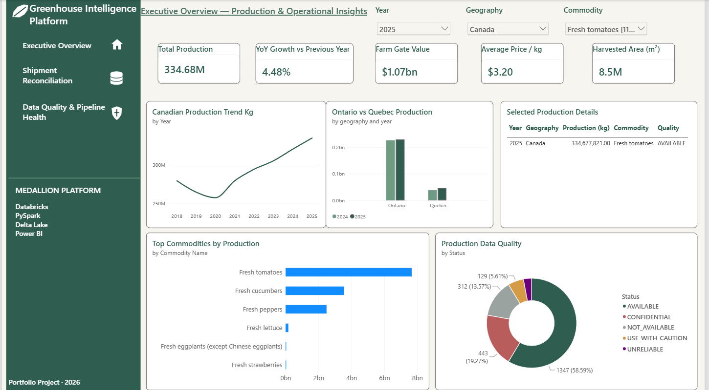
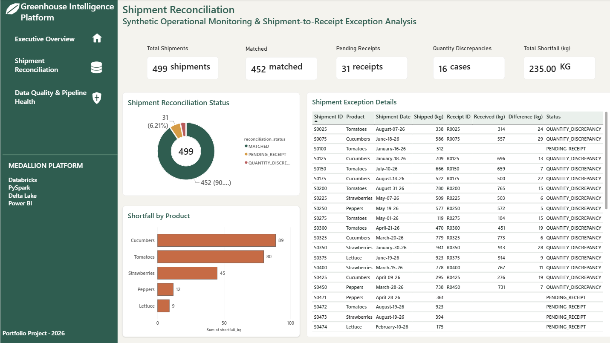
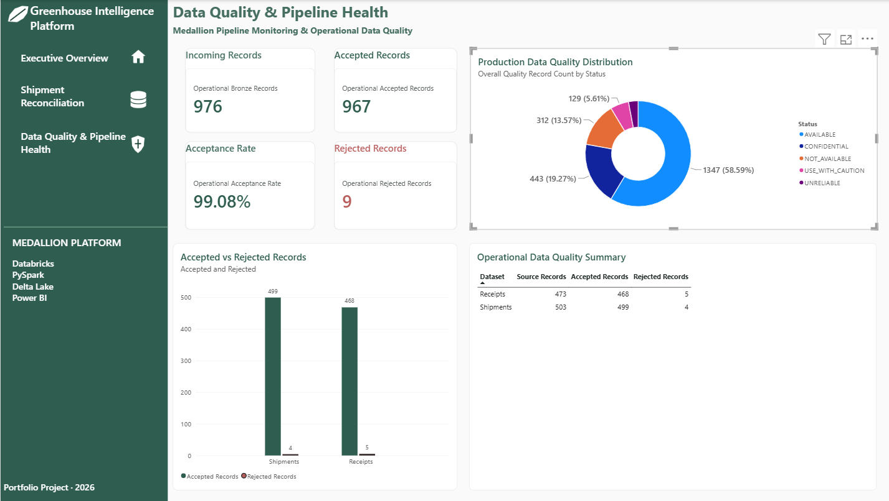

# Greenhouse Intelligence Medallion

End-to-end greenhouse analytics platform built with **Databricks, PySpark, Delta Lake, SQL, and Power BI** using a **Bronze → Silver → Gold Medallion Architecture**.

The project combines two intentionally separate domains:

- **Public Statistics Canada greenhouse production data** for historical production, farm-gate value, harvested area, average price, geography, commodity, and data-quality analysis.
- **Synthetic operational shipment and receipt data** created only to demonstrate validation, quarantine, reconciliation, exception monitoring, and operational KPI reporting.

> **Important:** Shipment and receipt data in this repository is synthetic. It does not represent private operational data from Statistics Canada or any real company.

---

## Project Objectives

This project demonstrates how a modern analytics platform can:

- ingest raw data into Delta Lake
- standardize and validate records in a Silver layer
- preserve suppressed, unavailable, unreliable, and caution-flagged observations correctly
- standardize comparable units without double-counting alternate representations
- build business-ready Gold facts and reporting views
- reconcile shipment and receipt records at shipment grain
- quarantine invalid operational records for auditability
- surface data-quality and operational exceptions in Power BI

---

## Architecture

```text
PUBLIC DATA
Statistics Canada CSV
        │
        ▼
     BRONZE
Raw ingestion + metadata
        │
        ▼
      SILVER
Standardization + validation + quality classification
        │
        ▼
       GOLD
Business-ready Delta facts/views
        │
        ▼
     POWER BI
Executive analytics + monitoring

SYNTHETIC OPERATIONS
Products + Shipments + Receipts
        │
        ▼
     BRONZE
Raw Delta tables
        │
        ▼
      SILVER
Valid records + quarantine tables
        │
        ▼
       GOLD
Shipment reconciliation model
        │
        ▼
     POWER BI
Reconciliation + pipeline health
```

A visual architecture diagram will be stored under `docs/architecture/`.

---

## Technology Stack

| Layer | Technology |
|---|---|
| Data Platform | Databricks |
| Processing | PySpark |
| Storage | Delta Lake |
| Querying | Spark SQL / SQL |
| Architecture | Medallion Architecture |
| BI | Power BI |
| Source Control | GitHub |
| Public Data | Statistics Canada |
| Operational Demo Data | Synthetic |

---

## Public Data Source

**Statistics Canada Table 32-10-0456-01 — Production and Value of Greenhouse Fruits and Vegetables**

Official CSV download:

```text
https://www150.statcan.gc.ca/n1/tbl/csv/32100456-eng.zip
```

The source contains **16,684 records** and covers greenhouse production/value observations across Canada and provinces.

Key source dimensions include:

- reporting year
- geography
- commodity
- production/value measure
- estimate type
- unit of measure
- observation value
- Statistics Canada status flag

---

## Data Quality Rules

Statistics Canada status codes are preserved and surfaced rather than overwritten.

| Source Status | Interpretation | Project Treatment |
|---|---|---|
| blank | Available | AVAILABLE |
| E | Use with caution | USE_WITH_CAUTION |
| x | Confidentiality suppression | CONFIDENTIAL |
| .. | Not available | NOT_AVAILABLE |
| F | Too unreliable | UNRELIABLE |

Missing or suppressed measurements are **never converted to zero**.

---

## Medallion Architecture

### Bronze

Public Bronze table:

```text
workspace.greenhouse_bronze.raw_production
```

Operational Bronze tables:

```text
workspace.greenhouse_bronze.raw_products
workspace.greenhouse_bronze.raw_shipments
workspace.greenhouse_bronze.raw_receipts
```

Operational source counts:

| Dataset | Records |
|---|---:|
| Products | 5 |
| Shipments | 503 |
| Receipts | 473 |

### Silver

The Silver layer performs:

- column standardization
- type casting
- quality classification
- duplicate detection
- invalid quantity detection
- missing identifier checks
- orphan checks
- quarantine of invalid operational records

Public Silver table:

```text
workspace.greenhouse_silver.production_clean
```

Public Silver count: **16,684**

Operational Silver outputs:

```text
workspace.greenhouse_silver.products_clean
workspace.greenhouse_silver.shipments_clean
workspace.greenhouse_silver.shipments_quarantine
workspace.greenhouse_silver.receipts_clean
workspace.greenhouse_silver.receipts_quarantine
```

Operational validation results:

| Dataset | Bronze | Accepted | Rejected |
|---|---:|---:|---:|
| Shipments | 503 | 499 | 4 |
| Receipts | 473 | 468 | 5 |
| **Total** | **976** | **967** | **9** |

Acceptance rate: **99.08%**

### Gold

#### Mass Production

```text
workspace.greenhouse_gold.fact_production_mass
```

Business grain: **Year + Geography + Commodity**

Record count: **2,299**

Mass-unit rule:

- prefer reported kilograms
- otherwise convert pounds using `lb × 0.45359237`
- never sum reported kg and lb representations together

Production quality distribution:

| Quality | Records |
|---|---:|
| AVAILABLE | 1,347 |
| USE_WITH_CAUTION | 129 |
| CONFIDENTIAL | 443 |
| NOT_AVAILABLE | 312 |
| UNRELIABLE | 68 |

#### Farm-Gate Value

```text
workspace.greenhouse_gold.fact_farm_gate_value
```

- total groups: **3,048**
- numeric values: **1,876**
- missing/suppressed: **1,172**

#### Harvested Area

```text
workspace.greenhouse_gold.fact_harvested_area
```

Rule:

- prefer reported square metres
- otherwise convert square feet using `1 sq ft = 0.09290304 m²`
- never sum alternate unit representations

- total groups: **2,050**
- numeric values: **1,183**
- missing/suppressed: **867**

#### Average Price

```text
workspace.greenhouse_gold.fact_average_price_mass
```

Rule:

- prefer reported CAD/kg
- otherwise convert CAD/lb using `$/lb × 2.20462262`
- count-based prices such as $/dozen and $/head remain separate

- total groups: **2,299**
- numeric values: **1,341**
- missing/suppressed: **958**

---

## Reporting Views

### Greenhouse Analytics

```text
workspace.greenhouse_gold.vw_greenhouse_analytics
```

Combines production with farm-gate value, harvested area, and average price while preserving the production grain.

Row count: **2,299**

### Year-over-Year Production

```text
workspace.greenhouse_gold.vw_production_yoy
```

Approved YoY growth is returned only when:

- the previous observation is exactly the prior calendar year
- previous production is greater than zero
- both current and previous observations are `AVAILABLE`

This prevents caution-flagged or discontinuous observations from being presented as approved KPI growth.

---

## Synthetic Shipment Reconciliation

The operational domain was generated specifically for demonstration and contains controlled data-quality scenarios such as:

- duplicate shipment IDs
- missing shipment IDs
- negative shipped quantities
- duplicate receipt IDs
- missing receipt IDs
- negative received quantities
- missing receipts
- shipment/receipt quantity differences

Gold reconciliation fact:

```text
workspace.greenhouse_gold.fact_shipment_reconciliation
```

Results:

| Reconciliation Status | Shipments |
|---|---:|
| MATCHED | 452 |
| PENDING_RECEIPT | 31 |
| QUANTITY_DISCREPANCY | 16 |
| **Total** | **499** |

Total operational shortfall: **235 kg**

---

## Power BI Dashboard

The Power BI report contains three pages.

### Executive Overview

Includes production KPIs, rolling production trend, Ontario vs Quebec comparison, top commodities, selected production details, and production-quality distribution.



### Shipment Reconciliation

Includes shipment KPIs, reconciliation-status distribution, shortfall by product, and shipment-level exception details.



### Data Quality & Pipeline Health

Includes incoming/accepted/rejected record KPIs, acceptance rate, accepted vs rejected comparison, production-quality distribution, and operational quality summary.



---

## Repository Structure

```text
greenhouse-intelligence-medallion/
│
├── README.md
├── notebooks/
│   ├── 01_Bronze_Data_Ingestion.py
│   ├── 02_Silver_Data_Transformation.py
│   ├── 03_Gold_Data_Modeling.py
│   └── 04_Operational_Reconciliation.py
│
├── sql/
│   └── gold_reporting_views.sql
│
├── docs/
│   ├── architecture/
│   │   └── medallion_architecture.png
│   ├── dashboard/
│   │   ├── executive_overview.png
│   │   ├── shipment_reconciliation.png
│   │   └── data_quality_pipeline_health.png
│   ├── business_rules.md
│   ├── data_dictionary.md
│   └── source_to_target_mapping.md
│
└── LICENSE
```

---

## Key Design Decisions

1. **Preserve source quality semantics** — suppressed and unavailable values remain null rather than being replaced with zero.
2. **Avoid unit double-counting** — alternate unit representations are standardized using precedence rules rather than summed.
3. **Protect business grain** — Gold facts are validated for duplicate business keys before persistence.
4. **Separate public analytics from synthetic operations** — shipment and receipt data is never represented as Statistics Canada operational data.
5. **Use quarantine instead of silent rejection** — invalid operational records remain auditable through Silver quarantine tables.
6. **Apply quality-aware KPI logic** — YoY growth is approved only when both periods meet required quality rules.

---

## Example Analytical Result

For **Canada — Fresh tomatoes**:

```text
2024 production: 320,326,951 kg
2025 production: 334,677,821 kg
Approved YoY growth: +4.48%
```

For Ontario:

```text
2024 production: 226,090,448 kg
2025 production: 228,848,375 kg
Approved YoY growth: +1.22%
```

A mathematically valid change can still be excluded from an approved KPI when source-quality rules are not satisfied.

---

## Data Governance Notes

- Statistics Canada remains the source authority for the public greenhouse dataset.
- Source quality flags are retained throughout transformation.
- Synthetic operational records are explicitly labeled and kept logically separate from public production measurements.
- No credentials, personal data, or proprietary company data are included in this repository.

---

## Future Enhancements

Potential extensions include:

- automated Databricks Workflows orchestration
- incremental Bronze ingestion
- Delta Change Data Feed
- formal expectation-based data-quality framework
- CI/CD for notebooks and SQL objects
- dimensional date/geography/commodity models
- Power BI deployment pipeline
- automated pipeline monitoring and alerting

---

## License

This project is released under the MIT License.

Public source data remains subject to the terms and conditions of Statistics Canada.
